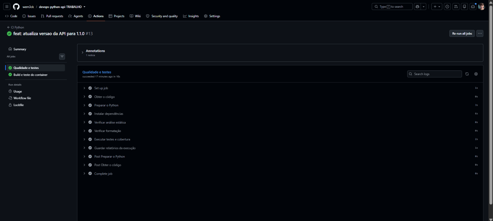
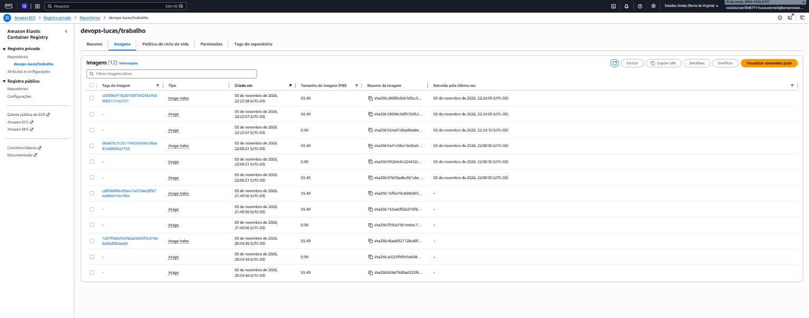
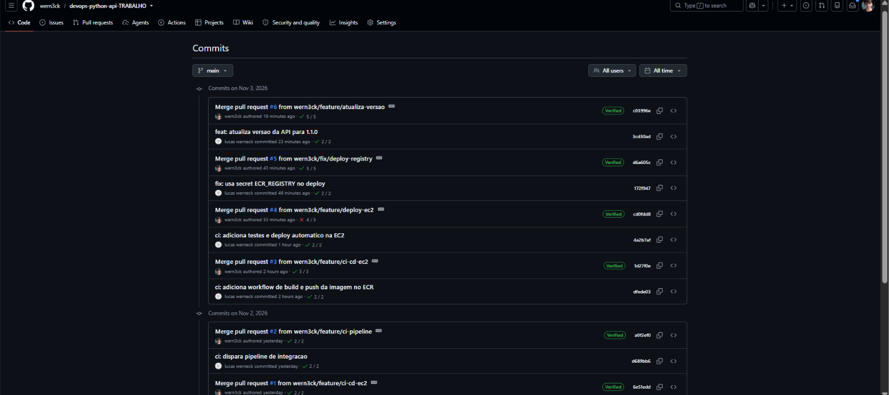
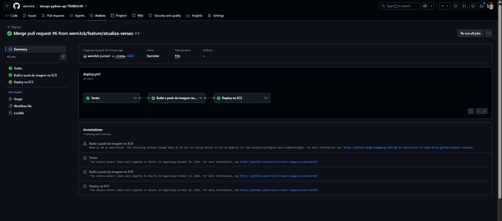
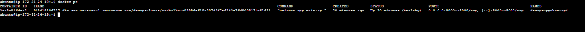
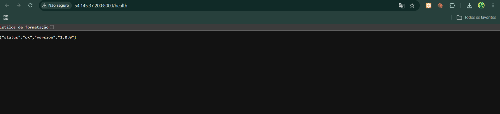
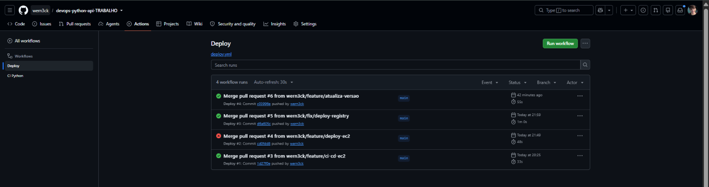
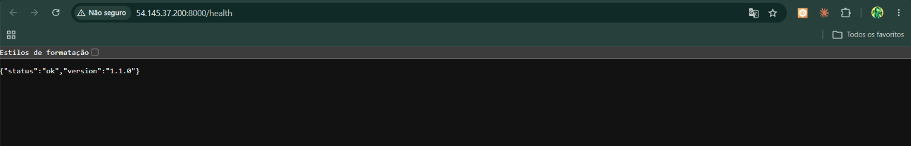

# devops-python-api

API em Python (FastAPI) usada para demonstrar uma pipeline completa de CI/CD com GitHub Actions, Docker, Amazon ECR e Amazon EC2.

## Tecnologias
Python, FastAPI, Uvicorn, Pytest, Docker, GitHub Actions, Amazon ECR, Amazon EC2.

## Execução local
```bash
python -m pip install --requirement requirements-dev.txt
python -m uvicorn app.main:app --reload
python -m pytest
```
A API fica em http://localhost:8000 (endpoint de saúde: `/health`).

## Docker
```bash
docker build -t devops-python-api:local .
docker run --rm -p 8000:8000 devops-python-api:local
```

## Pipeline de integração contínua (`ci.yml`)
Executada na abertura ou atualização de um Pull Request para a `main` e também a cada push na `main`. O workflow tem dois jobs:
1. **Qualidade e testes:** baixa o código, configura o Python, instala as dependências, roda a análise estática (`ruff`) e o `pytest`. Informa sucesso ou falha.
2. **Build e teste do container:** constrói a imagem Docker e testa o container.

## Pipeline de entrega contínua (`deploy.yml`)
Executada a cada push na `main`, em três jobs encadeados:
1. **Testes:** roda o `pytest`.
2. **Build e push:** (só se os testes passarem) autentica na AWS, faz login no ECR, constrói a imagem e a envia ao ECR com a tag do commit (`github.sha`).
3. **Deploy na EC2:** (só se o job anterior passar) conecta por SSH, autentica o Docker no ECR, baixa a imagem do commit, substitui o container anterior, inicia o novo e verifica se está em execução.

## Arquitetura
```
Desenvolvedor → Branch → Pull Request → CI (testes) → Merge na main
→ GitHub Actions → Build Docker → Amazon ECR → SSH → EC2 (container Docker, porta 8000)
```
A EC2 (Ubuntu, Docker instalado) lê imagens privadas do ECR por meio de uma IAM Role. As credenciais ficam em GitHub Secrets.

## Secrets do GitHub utilizados
`AWS_ACCESS_KEY_ID`, `AWS_SECRET_ACCESS_KEY`, `AWS_SESSION_TOKEN`, `AWS_REGION`, `ECR_REGISTRY`, `ECR_REPOSITORY`, `EC2_HOST`, `EC2_USER`, `EC2_SSH_KEY`. Os valores não são versionados.

## Acesso à API
http://54.145.37.200:8000/health

(O endereço só responde enquanto a instância estiver ligada. Após a avaliação, os recursos da AWS serão encerrados.)

## Verificar a versão implantada
```bash
curl http://54.145.37.200:8000/health
```
Resposta esperada: `{"status":"ok","version":"1.1.0"}`


## Evidências

### A. Repositório GitHub
https://github.com/wern3ck/devops-python-api-TRABALHO

### B. Evidências da integração contínua
Execução bem-sucedida dos testes automatizados no GitHub Actions:



### C. Evidências da publicação Docker
Imagens publicadas no Amazon ECR, identificadas pela tag do commit:



Commits correspondentes às tags das imagens:



### D. Evidências do deploy
Pipeline de deploy executada com sucesso (primeiro deploy):



Container em execução na instância EC2:



Aplicação acessível pelo navegador:



### E. Evidência de atualização automática
Versão 1.0.0 (primeiro deploy):


Segundo deploy, disparado automaticamente pelo merge do PR #6:


Execuções do workflow Deploy (primeiro e segundo deploy):



Versão 1.1.0 (após a atualização automática, sem comandos manuais na EC2):



### F. Pull Requests
- [PR #1](https://github.com/wern3ck/devops-python-api-TRABALHO/pull/1): preparação inicial do projeto (branch `feature/ci-cd-ec2`)
- [PR #2](https://github.com/wern3ck/devops-python-api-TRABALHO/pull/2): pipeline de integração contínua (CI)
- [PR #3](https://github.com/wern3ck/devops-python-api-TRABALHO/pull/3): workflow de build e push da imagem no ECR
- [PR #4](https://github.com/wern3ck/devops-python-api-TRABALHO/pull/4): testes e deploy automático na EC2
- [PR #5](https://github.com/wern3ck/devops-python-api-TRABALHO/pull/5): correção do registry do ECR no deploy
- [PR #6](https://github.com/wern3ck/devops-python-api-TRABALHO/pull/6): atualização da versão da API para 1.1.0